# 交易结构压力指数工程框架

状态：`planned`
目标阶段：R4a → R4b → R4c
产品事实源：[`behavior-pressure-product-spec.md`](../product/behavior-pressure-product-spec.md)
方法事实源：[`behavior-pressure-methodology.md`](../data/behavior-pressure-methodology.md)
指标事实源：[`behavior-indicator-catalog.md`](../data/behavior-indicator-catalog.md)

> 本文件是未来实施蓝图。当前仓库没有压力指数运行时代码、数据库适配器、迁移、任务、API、事件、
> schema、页面或指标生产者；`governance/interfaces.json` 与 `governance/metrics.json` 不登记 planned 项。
> R4A 的覆盖审计、simple baseline 和 shadow candidate 都先在隔离研究路径完成；候选未晋级前不创建
> 公共契约、Port、迁移或首页 API。

## 1. 架构目标与非目标

> 2026-08-07 状态更新：项目所有者批准候选五分面、十簇、研究分档按
> `behavior-pressure-research.v1` 在 R1 单股研究产品中实现。这里此前的“planned / promotion 后”限制继续
> 适用于**正式投资指标**，不再阻断研究指数实现；依赖方向、PIT、权利失败关闭、Port 数量和存储边界不变。

目标是把授权市场数据变成一个可重放、可修订、可解释的结构状态，并保持以下不变量：

- 来源操作先通过权利检查；
- 每个输入遵守 PIT 和修订时间；
- 缺失核心数据时 abstain；
- 计算是纯函数、确定性、版本化；
- 快照追加写，不覆盖历史；
- 任务、快照、分档变化和 outbox 幂等；
- 行为变化是 `system_inference`，不是市场事实或方向预测；
- API、前端和 LLM 不重复计算领域规则。

本阶段不接入真实交易，不实现逐笔/L1/L2，不训练压力权重，不建立行为专用通知 Port，也不扩义预测
契约或情景文本记忆。

## 2. 前置闸门

R4 不能因为文档和 Port 已声明就跳过 R1–R3。进入 R4a 前，以下能力必须已有真实适配器、契约测试和
失败路径，而不只是 Protocol：

1. `InstrumentMasterDataPort`、`SectorCatalogPort` 和 `TradingCalendarPort`；
2. `RightsPolicyPort`、来源 rights registry 和每动作失败关闭；
3. `ObjectStorePort`、PostgreSQL repository、`UnitOfWorkPort` 和 R2 事务 outbox/relay；
4. 证券、交易板块、行业和地区的双时态 PIT 数据来源；
5. R3 通用今日/关注聚合资源、inbox projection、SSE 续传与站内消息外壳；
6. SeaweedFS/Valkey 目标基础设施通过恢复与故障演练；
7. `JobDispatcherPort`/`SchedulerPort` 真实 adapter 能为每次触发生成新的 `JobRequest`、`as_of` 与幂等键；
8. 至少一个市场数据来源的外部合同/权利评审明确允许获取、保留和派生分析。

这些是“可开始用合成 fixture 编码”的进入条件。真实数据激活还要求 R4a 先完成：`DERIVE` 全契约链、
行情/股本/公司行为/交易规则 revision、`MarketDataRepositoryPort` 双时间查询、来源 capability 启用及
零行阻断 manifest/恢复测试。此前不得真实 FETCH、保留或计算。

当前这些运行时能力尚未完整实现，因此本轮只做框架规划。

## 3. 固定依赖方向

```text
contracts/common
      ↑
ports (2 planned repositories only)
      ↑
modules/behavior pure domain + application use case
      ↑
platform/db + platform/market_data adapters
      ↑
apps/worker + apps/api + apps/web composition/transport
```

第三方库只可出现在 `platform`、`ml` 或组合根。`modules/behavior` 不 import TA-Lib、Polars、SQLAlchemy、
pgvector、Celery、FastAPI 或 LLM SDK。

## 4. 现有能力复用

### 4.1 强制复用

| 能力 | 现有定义 | R4 用法 |
|---|---|---|
| 操作与时间上下文 | `OperationContext`、`MutationContext` | PIT、deadline、correlation、幂等 |
| 分页与 HTTP 信封 | `CursorPage`、`ApiResponse`、`ProblemDetails` | 集合查询与 RFC 9457 错误 |
| 证券身份 | `InstrumentRef` | 证券稳定标识 |
| 行情原语 | `MarketBar` | 被 revision 包装，不复制 OHLCV 定义 |
| 特征原语 | `FeatureObservation` | 被证券/证据包装，不独立充当 SoR |
| 文档证据 | `EvidenceRef` | 只用于事件/公告轴，不强塞给行情 revision |
| 后台任务 | `JobRequest` | 计算任务信封 |
| 消息 | `MessageEnvelope`、`MessagePublishRequest` | 分档变化事件 |
| 来源与权利 | `SourceConnectorPort`、`RightsPolicyPort`、`ObjectStorePort` | 授权获取、保留和派生 |
| 主数据 | `InstrumentMasterDataPort`、`SectorCatalogPort`、`TradingCalendarPort` | PIT 证券/同行/交易窗口 |
| 事实上下文 | `MarketEventRepositoryPort` | 双轴读模型，不改变行为分数 |
| 消息与事务 | `MessagePublisherPort`、`UnitOfWorkPort` | outbox 发布和原子性 |

`MarketQuotePort` 继续只表达最新报价；不得扩义为历史/PIT 行情仓库。

### 4.2 明确不复用

- `QuantitativeForecastPort`、`ForecastFusionPort`、`ForecastOutcomePort`；
- `predictions`、`prediction_outcomes`；
- `EpisodicMemoryPort` 作为结构化压力主存储；
- `Notification`、`NotificationDeliveryPort` 作为行为提醒，因为现有契约强绑定市场事件 revision；
- `MarketEvent` 表达分档变化。

## 5. 候选晋级后的接口缺口

只有 promoted formula 已获所有者批准，且同阶段存在真实 consumer 与 provider/紧邻 provider 包时，才
评估新增两个 Repository Port。理由必须保持精确：

1. 最新报价端口无法表达追加式历史行情、修订、PIT 查询、股本、公司行为、交易规则、manifest 和来源
   缺口；
2. 文本情景记忆无法表达结构化 assessment、贡献簇、盘面状态、历史相似结果、分档连续状态和提醒幂等；
3. 预测存储的概率语义与本产品的非预测状态语义冲突。

除下述两个 Port 外，不规划第三个 Port。压力计算器和盘面状态分类器都是领域纯函数；结构状态作为同一
assessment 的可独立降级子对象，由 `BehaviorPressureRepositoryPort` 一并保存和读取。

## 6. 两个 R1 研究产品 Port

2026-08-07 的 R1 冻结已经形成同阶段真实 consumer/provider 工作包，并在
`governance/delivery.json.port_lifecycle` 登记引入与到期阶段，因此以下两个 Port 从 planned 转为
`declared`。`declared` 只表示接口存在；生产 adapter、组合和运行证据仍由对应实现包提供，不能提前宣称。

### 6.1 `MarketDataRepositoryPort`

计划归属：`src/stock_assistant/ports/persistence.py`

```text
append_revisions(MarketDataRevisionAppendRequest)
  -> MarketDataRevisionAppendResult

query_revisions(MarketDataRevisionQuery)
  -> MarketDataRevisionPage
```

职责：

- 幂等追加行情、股本、公司行为和交易规则 revision；
- 按 `context.as_of` 和业务有效时间执行 PIT 查询；
- 返回不透明 cursor、`MarketDataManifest`、rights hashes 和稳定 source gap reason codes；
- 对每条 revision 同时执行 `available_at <= as_of` 与 `revision_known_at <= as_of`；
- 不返回 ORM、Parquet 路径、SQLAlchemy Session 或供应商响应。

未来登记 ID：`port:persistence.market-data-repository:v1.0`。

### 6.2 `BehaviorPressureRepositoryPort`

计划归属：`src/stock_assistant/ports/persistence.py`

```text
save_assessment(BehaviorPressureAssessmentWriteRequest)
  -> BehaviorPressureAssessmentWriteResult

query_assessments(BehaviorPressureQuery)
  -> BehaviorPressurePage

query_analog_candidates(HistoricalAnalogCandidateQuery)
  -> HistoricalAnalogCandidatePage

get_transition_state(BehaviorTransitionStateLookup)
  -> BehaviorTransitionStateLookupResult

save_transition_state(BehaviorTransitionStateWriteRequest)
  -> BehaviorTransitionStateWriteResult
```

职责：

- 幂等保存 assessment、贡献簇、指标观测、必需六槽盘面 profile、相似样本审计和成熟结果；
- 游标查询最新或历史快照；
- 召回历史相似候选，应用层再执行精确距离与 PIT 复核；
- 持久化跨 worker 重启的连续分档状态；
- 以 expected revision/唯一键保护并发；
- 只写 assessment、analog/outcome 和 transition state，不直接写 outbox；应用用例调用 R2 outbox writer，
  composition root/UoW 让二者在同一事务提交，避免双写。

未来登记 ID：`port:persistence.behavior-pressure-repository:v1.0`。

## 7. planned 契约

### 7.1 `contracts/market_data.py`

| 契约 | 关键职责 |
|---|---|
| `MarketBarRevision` | 组合现有 `MarketBar`，补 `available_at`、`revision_known_at`、first seen、supersedes 和 lineage |
| `MarketDataManifest` | 数据总体、窗口、源、状态、可空对象引用、rights、行数和内容 hash |
| `MarketDataLineageRef` | 轻量行情 lineage：manifest/revision/source-record、时间和可空行定位；不伪造文档 URL/标题 |
| `ShareCapitalObservation` | 总股本/自由流通股本的业务有效期与系统已知时间 |
| `CorporateActionObservation` | 分红、送转、拆并股、除权及当时可见复权信息 |
| `TradingRuleSnapshot` | 板块、ST、停牌、IPO 特殊期、涨跌停规则与双时态 |
| append/query/page 契约 | revision discriminated union、幂等写入、PIT 有界查询和缺口 |

`MarketBar` 不新增重复 OHLCV 字段；wrapper 负责 revision/lineage。其 `available_at` 表示该 revision
最早可合法用于计算的时间，现有 `MarketBar.received_at` 保留实际接收时间，两者不得互相冒充；wrapper
的 `revision_known_at` 决定特定修订何时进入系统知识。初始与更正 revision 均强制
`available_at <= received_at <= revision_known_at`，违反时契约拒绝。`FeatureObservation` 若跨边界使用，必须被证券、
rights、market lineage 和 manifest wrapper 组合，不能单独成为事实主记录。

`MarketDataManifest` 支持零行 `blocked/incomplete` 状态：权利在 fetch 前阻断时不创建对象引用或行情
lineage，但仍以请求窗口、来源、rights decision 和缺口码形成确定性 manifest hash。这样可以幂等保存
不含受限数据的 abstained assessment，而无需给 `CursorPage` 增加页级私有状态。

### 7.2 `contracts/behavior.py` 候选边界

覆盖审计、simple baseline 与 shadow candidate 只使用隔离研究模型，不创建公共 product contract。
promotion 后才根据实验证据决定正式字段；以下仅是兼容候选清单，不是冻结 Schema：

- `PressureMode` 候选：`intraday_10m`、`post_close`；
- `PressureAvailability` 候选：`ready`、`degraded`、`abstained`；
- `PressureBand`、五分面和十贡献簇枚举必须由 promotion 决定，未晋级时不得发布；
- `IndicatorRole`、`ObservationClass`、`ComparisonPopulationKind`；后者固定区分证券/行业/市场的日线与
  同钟点盘中六种连续总体，以及离散规则总体；
- `BehaviorIndicatorObservation`、`PressureClusterContribution`；
- `PressureFacet`；
- `PressureDataQuality`；
- `MarketStructureDimension`、`MarketStructureState`、`MarketStructureAvailability`、
  `MarketStructureDimensionAssessment`、`MarketStructureProfile`；
- `PressureComparisonSemantics`：公式/特征/精度/规则/分档/同行/参考映射版本与规范 hash；
- `PressureExplanationPolicy`：版本、贡献阈值、稳定排序和 3/2 上限；
- `HistoricalAnalogState`：`pending`、`ready`、`insufficient`、`maturity_pending`、`incomparable`、`failed`；
- `HistoricalOutcomeDistribution`、`HistoricalAnalogSummary`；
- `BehaviorPressureSnapshot`；
- `BehaviorBandTransition`；
- 任务 payload、repository query/write/result 和 transition state 契约。

R3 通用今日/关注聚合读模型的既有 contract 在 R4a 出现真实调用方后兼容增加
`EventAxisState`、`BehaviorAxisState`、`AxisRelationship` 和 `AxisRelationshipBasis`。关系由 portfolio
应用层的确定性纯函数按产品规格映射，事件输入窗口固定为相邻可比 assessment 的
`(previous.as_of, current.as_of]`，并携带事件 revision、assessment、两个窗口和规则版本；它不是新
Port，也不放进单独的压力 snapshot。累计简报事件窗口只用于事件列表，不能重复参与后续关系判断。

### 7.3 晋级后 `BehaviorPressureSnapshot` 的最低不变量

- 只有 promotion 决定正式分数与分档后，`score` 与 `band` 才同时存在或同时为空；
- 正式分面/簇数量、权重和门槛由 promotion 产物写入版本语义，不从当前候选文档硬编码；
- 缺任一晋级公式要求的核心输入时状态为 `abstained`，不得补零或静默重分配；
- `MarketStructureProfile` 必须存在并恰有趋势组织、位置与修复、成交参与、波动环境、盘中接受、相对
  环境六个维度槽；每槽有独立 `ready/degraded/abstained/not_applicable`、可空 state、稳定 reason、quality、
  支持和反证，因此压力 abstain 时完整诊断仍可显示，单项诊断缺失也不抹掉压力分；
- `ready/degraded` 维度必须有 state，`abstained/not_applicable` 的 state 必须为空；`post_close` 的盘中接受
  固定为 `not_applicable`，不能把“未到盘中”或“数据不足”混入 `MarketStructureState`；
- profile 至少一个适用维度可用但其余适用维度不完整时为 `degraded`，所有适用维度均无法分类时为
  `abstained`；profile availability 与压力 availability 相互独立；
- 诊断状态携带 `diagnostic_semantics_hash`、支持/反证 indicator IDs 和当时已物化文案，不参与
  `comparison_semantics_hash` 或总分；
- `ready/degraded` 必须有完整输入 manifest、market lineage 和可追溯 rights；`abstained` 可使用零行
  blocked/incomplete manifest，但必须有 rights decision/hash 和稳定 reason code；
- historical analog 只允许挂在 `post_close`；
- comparison 只允许同 mode、同 `comparison_semantics_hash`；首次基线或版本边界的
  `comparison_assessment_id/delta` 为空，且不能触发 transition；
- `comparison_semantics_hash` 变化必须同步提升 umbrella `formula_version`；每日 peer/reference manifest
  变化只进入 `data_manifest_hash`，不冒充语义变化；
- assessment 严格满足 `window_end <= as_of <= generated_at <= revision_known_at`；
- `ready/degraded` 的 formula、feature、rule、band、peer、reference、manifest、rights、lineage 和 explanation
  版本齐全；`abstained` 只强制 mode/window/as-of、formula、availability、reason、rights decision/hash
  与 blocked/incomplete manifest，feature/rule/peer/reference/lineage 可按阻断阶段为空；
- assessment 保存 `explanation_version`、阈值、稳定排序后的 selected driver/mitigator cluster 及其贡献；旧快照
  只展示已物化解释，不用当前策略重新生成；
- 供应商更正追加新快照并设置 `supersedes_assessment_id`；
- 禁止字段：`probability`、`confidence`、`expected_return`、`buy_signal`、`sell_signal`。

## 8. 纯函数领域目录

```text
src/stock_assistant/modules/behavior/
├── __init__.py
├── formulas.py       # 论文代理与标准技术原语的项目语义
├── percentiles.py    # mid-rank、证券/行业/市场/同钟点参照总体
├── indicator_catalog.py # 指标角色、父子关系、可观察等级和版本
├── clusters.py       # 晋级前仅承载影子候选；十簇、五分面和总分均非冻结事实
├── structure_states.py # 六维盘面状态及支持/反证
├── analogs.py        # 精确距离、PIT、去相关和结果分布
├── transitions.py    # 连续两窗、同日同目标档抑制
├── explanations.py   # 由贡献排序生成确定性驱动/反证
└── relationships.py  # 双轴稳定枚举映射；不依赖 LLM
```

所有函数无 I/O、网络、时钟、UUID 生成、数据库或 LLM。时间、版本、ID 和总体均由调用方显式传入。
`explanations.py` 只将结构化贡献簇和已分类状态映射为受控文案，不生成自由文本结论。指标目录是静态、
版本化输入，不在运行时自动发现或学习指标。

## 9. planned 应用流程

```mermaid
flowchart LR
    A["SourceConnectorPort"] --> B["RightsPolicyPort: FETCH / RETAIN / DERIVE"]
    B --> C["Raw object + MarketDataManifest"]
    C --> D["Append-only market/capital/rule revisions"]
    D --> E["MarketDataRepositoryPort"]
    E --> F["Pure cluster calculator + structure classifier"]
    F --> G["BehaviorPressureRepositoryPort"]
    G --> H["Collection API"]
    H --> I["Today / holding dual-axis read model"]
    G --> J["BehaviorBandTransition"]
    J --> K["R2 transactional outbox"]
    K --> M["Commit-after outbox relay"]
    M --> N["MessagePublisherPort"]
    N --> L["R3 inbox projection + SSE"]
```



计算用例在打开数据库事务前完成外部读取。request-scoped composition root 让
`BehaviorPressureRepositoryPort`、R2 outbox writer 与 `UnitOfWorkPort` 共享同一数据库 session，在短事务
内原子写入 assessment、transition state 和 outbox；commit 后独立 relay 才调用
`MessagePublisherPort`。不为此增加第三个 R4 Port。

`MarketStructureProfile` 作为 `BehaviorPressureSnapshot` 的必需嵌套子对象随同一集合返回，不新增
structure 专用 Port、HTTP、任务或事件。它有独立 availability/quality 和语义 hash；仅诊断规则变化可
产生新的 assessment revision，但不能形成压力 delta 或分档 transition。

## 10. planned 公共 HTTP

唯一行为集合资源：

```http
GET /api/v1/instruments/{instrument_id}/behavior-pressure-snapshots
```

查询参数：`mode`、`as_of`、`cursor`、`limit`。

- `mode` 省略时固定为 `post_close`；cursor 必须签名绑定 instrument、mode、query-as-of、排序键和契约
  版本，跨 mode、过期或被篡改的 cursor 使用 RFC 9457 拒绝；
- `limit=1` 返回指定截止时间前最新快照；
- 默认按 `window_end DESC, revision_known_at DESC, assessment_id DESC` 形成全序；cursor 签名编码全部
  三个排序键，相同时间戳分页不得漏项或重复；
- 查询参数 `as_of` 是系统知识截止时间，同时要求 assessment 自身 `as_of <= query_as_of`、
  `generated_at <= query_as_of` 且 `revision_known_at <= query_as_of`；延迟生成结果和后来才知道的供应商
  更正均不得泄漏进历史查询；
- 返回 `ApiResponse[CursorPage[BehaviorPressureSnapshot]]`；
- 核心自身/同行/参考总体不足、权利阻断和核心数据缺失通过持久化 `abstained` snapshot item 表达；
  数据仍可计算但过期时为 `degraded`；analog `n < 50` 只设置嵌套
  `HistoricalAnalogState=insufficient`，主体 assessment 状态和分数不改变；
- 从未运行过才返回空页，不能用空页暗示权利正常；
- 参数错误和未知证券使用 RFC 9457；
- 不创建行为专用 latest、analog 或 notification HTTP 资源。

前期只物化一个主动关注标的，今日页不得扩展为多证券 fan-out 后在浏览器排序。R3 必须先实现并登记
一个不含压力字段的通用今日/关注聚合资源；R4a 出现真实调用方后，复用同一摘要 contract 兼容增加
`behavior_pressure_summary`、双轴关系和服务端排序。本轮不预选该 R3 资源 URL，也不预建第二个行为接口。

R4c 对该摘要兼容增加 `BehaviorSummaryPhase`，由服务端按查询 `as_of`、交易日历和水位固定选择：
`LAST_CONFIRMED`、`INTRADAY_EXPECTED`、`INTRADAY_ACTIVE`、`POST_CLOSE_PENDING`、
`CURRENT_CONFIRMED`。当前窗口应有但缺失时返回等待/延迟状态，当前 assessment 为 degraded/abstained 时
原样返回；不得静默退回旧 ready 值。临时切确认只替换摘要，不产生跨 mode delta/transition。服务端列表
排序固定为向上跨档、向下跨档、同档变化、口径切换/不可比较、首次基线、无变化六层，再以窗口和证券
键形成全序；前端刷新与 SSE 只消费该投影，不另选 mode 或重排。

## 11. planned 任务与事件

### 11.1 计算任务

```text
stock_assistant.behavior.compute.v1
```

payload 只含 `PressureMode`、主动关注标的 revision、完整窗口、公式版本、诊断语义版本和必要 manifest 引用，外层复用
`JobRequest` 及其原始幂等键。真实 scheduler/dispatcher 为每次 firing 新建 request/as-of/幂等键，不能
复用静态模板。任务不得携带全市场 bars、ORM 对象或供应商 payload。

### 11.2 分档事件

```text
com.stockassistant.behavior.band_transition.v1
```

payload 固定 `inference_kind=system_inference`，包含 from/to assessment、from/to band、方向、连续窗口数、
交易日、公式版本和 `market_data_lineage_refs`。外层复用 `MessageEnvelope`。

transition/outbox/inbox 贯穿使用稳定业务幂等键：

```text
sha256(UTF-8(event_name + "\\n" + instrument_id + "\\n" + mode + "\\n"
       + ISO-8601(trading_date) + "\\n" + target_band))
```

Job ID、message ID 或人工重放变化不得改变该键。公式/比较口径边界本来就禁止 transition；同证券、
同 mode、同交易日再次进入相同目标档只更新审计状态，不生成第二条 inbox 提醒。

它不进入 `MarketEvent`，也不使用强绑定 market event revision 的 `Notification`。R4c 复用 R3 通用 outbox
和 SSE；若 R3 尚未实现，R4c 不得提前宣称完成。

## 12. 幂等与一致性

assessment 逻辑唯一键：

```text
instrument + mode + window_end + formula_version
+ diagnostic_semantics_hash + data_manifest_hash
```

`data_manifest_hash` 是完整计算输入 manifest 的规范 hash，必须覆盖行情 revision、股本/公司行为/交易
规则、同行总体成员与统计、参考状态样本及各自版本/hash；只改变任一输入的修订重算都会得到新键。
纯诊断口径更新由 `diagnostic_semantics_hash` 区分，但压力比较仍只检查 `comparison_semantics_hash`；
诊断 revision 本身不得触发分档事件。`diagnostic_semantics_hash` 始终非空；纯诊断 revision 必须设置
`supersedes_assessment_id`，但其压力 `comparison_assessment_id` 仍指向上一不同窗口、同压力比较语义的
assessment，不能指向同窗口旧诊断 revision，也不能创建 outbox。

未来新增迁移必须以数据库唯一约束保护，而非“先查再写”。同一计算任务重放 100 次只允许：

- 一个逻辑 assessment；
- 一个对应目标档 transition state；
- 一条待发布 outbox；
- 重放结果显式标记 idempotent replay。

盘中提醒状态保存在 PostgreSQL，不保存在 Valkey。Valkey 只缓存最新快照或连接状态，丢失后不影响
提醒抑制和审计。

## 13. planned 数据存储

未来只新增迁移，不修改 `20260721_0001_initial.py`。

| planned 表/对象 | 职责 |
|---|---|
| `market_data_manifests` | 数据总体、源、窗口、rights、对象和 hash |
| `market_bar_revisions` | bar revision 索引和 PIT 元数据；大数据体可指向 Parquet |
| `share_capital_observations` | 双时态股本 |
| `corporate_action_observations` | 双时态公司行为与复权依据 |
| `trading_rule_snapshots` | 板块/ST/停复牌/IPO/涨跌停规则 |
| `behavior_pressure_assessments` | 追加式快照、模式、分数、版本和替代关系 |
| `behavior_pressure_clusters` | 十个贡献簇、贡献、底层指标引用和版本 |
| `behavior_indicator_observations` | 原始值、指标角色、粒度及对应参照总体分位 |
| `behavior_structure_states` | 必需六槽 profile、维度 availability/state/reason、支持/反证、质量和诊断语义 hash |
| `behavior_peer_manifests` | 同行总体、规则、样本数和 hash |
| `behavior_analog_candidates` | 已冻结向量和候选选择审计；维度由 `analog_feature_set_version` 冻结后迁移 |
| `behavior_analog_outcomes` | 已成熟 1 日/3 日结果、MAE/MFE |
| `behavior_transition_state` | 连续窗口、同日目标档抑制和乐观版本 |

现有 `document_embeddings vector(1024)` 只属于文本记忆，不能混入行为相似向量。行为向量在冗余/PIT
门禁完成前不得预建固定维度；新旧 `analog_feature_set_version` 不混写。现有
`outbox_events` 的 message/idempotency/trace 扩展与唯一约束必须已由 R2 的分阶段 add-only migration
完成；R4 直接复用，不建立第二张行为 outbox 表。

存储介质：

- 原始供应商响应：SeaweedFS，仅在 RETAIN 允许时；
- 日线/10 分钟大数据：版本化 Parquet；
- manifest、双时态状态、assessment、analog/outcome 和 transition：PostgreSQL；
- 最新快照：Valkey 派生缓存，不能成为事实或提醒主存储。

## 14. planned 权利扩展

现有 `RightsOperation` 尚无 `DERIVE`，来源配置和检查器也没有 `derive_allowed`。未来必须在同一改动中
兼容扩展：

1. `contracts.ingestion.RightsOperation`；
2. `configs/sources.yaml` schema/字段；
3. `scripts/check_data_rights.py`；
4. runtime rights policy producer/consumer；
5. manifest、审计、测试和文档。

Tushare 只作为个人研究候选，默认禁用，直到来源登记明确允许对应的 FETCH、RETAIN、DERIVE。当前唯一
正式主线仍是 `source-policy.md` 中的 Choice/CNINFO/政府来源；不得在文档中同时声称 Tushare 是默认
生产主线。

## 15. planned 前端目录

```text
apps/web/
├── app/instruments/[instrumentId]/
├── components/workbench/
├── features/dual-axis/
└── features/behavior-pressure/
    ├── behavior-pressure-summary.tsx
    ├── pressure-facet-list.tsx
    ├── pressure-contributions.tsx
    ├── market-structure-profile.tsx
    ├── annotated-price-chart.tsx
    ├── annotated-intraday-chart.tsx
    ├── pressure-quality-state.tsx
    ├── mode-separated-history.tsx
    ├── historical-analogs.tsx
    ├── pressure-audit-details.tsx
    └── pressure-live-region.tsx
```

Server Component 为默认；只有证据面板交互、金融图表和 SSE live region 使用客户端岛。金融 K 线/分时
唯一使用 Lightweight Charts，宽度/分布等通用图使用 ECharts，职责不重叠。前端只映射稳定枚举、格式
和服务端排序，不计算分数、分档、贡献排名、盘面状态、参照总体分位或双轴关系。

## 16. planned 测试地图

```text
market revisions + rules
  └─ contract/PIT/A-share rules/migration tests
       └─ formulas + percentile + calculator unit tests
            └─ repository adapter contract tests
                 └─ compute use-case + idempotency integration
                      └─ worker → PostgreSQL → API → Web E2E
```

R4a：指标目录、同行覆盖、分粒度标准化、父子/冗余门禁、十贡献簇、六维中的五个盘后状态、golden vectors、
TA-Lib 对照、PIT、A 股规则、缺失、条件化高换手样例、API 和双轴详情。
R4b：十簇加五个盘后诊断候选的相似向量维度冻结、召回后精确复核、成熟标签、20 日去相关、`n < 50`、
1/3 日分布和 walk-forward。
R4c：五个重算簇、五个继承簇、证券/行业/市场同钟点总体、RVOL、VWAP 接受/拒绝、日内路径、午休/
停牌、水位、连续两窗、每日目标档抑制、worker 重启、SSE 与 100 次重放。

所有测试只使用脱敏合成 fixture，不访问真实网络、账户或行情。

## 17. planned 指标目录

只有真实生产者落地时才逐项登记，当前 `governance/metrics.json` 保持不变。候选观测量包括：

- assessment 计算数、耗时、失败和重放；
- ready/degraded/abstained、覆盖率、过期率和缺口 reason；
- 指标/贡献簇覆盖、参照总体不足、盘面状态变化和诊断误解护栏；
- 分档变化、连续窗口确认和提醒抑制；
- 1 日/3 日 MAE 排序 lift 和分数稳定性。

证券代码、evidence、request、持仓和原始错误文本不得成为 Prometheus 标签。

隔夜海外市场和跨境事件不进入本框架的计算、repository 或任务 payload。它们通过未来简报/今日读模型
作为事件轴上下文引用，并可在验证后作为“相对环境”的支持/反证；不新增外部行情/地缘 Port，也不改变
`MarketDataRepositoryPort` 与 `BehaviorPressureRepositoryPort` 的 planned 状态和压力公式职责。

## 18. 未来文件清单

以下均为 planned，不在本轮创建：

```text
src/stock_assistant/contracts/market_data.py
src/stock_assistant/contracts/behavior.py
src/stock_assistant/ports/persistence.py          # 兼容追加两个 Port
src/stock_assistant/modules/behavior/*
src/stock_assistant/platform/db/market_data_repository.py
src/stock_assistant/platform/db/behavior_repository.py
src/stock_assistant/platform/market_data/parquet_store.py
src/stock_assistant/platform/market_data/talib_primitives.py
apps/api/routes/behavior_pressure.py
apps/worker/tasks.py                              # 兼容新增任务
apps/worker/task_names.py                         # 兼容新增稳定名称
infra/migrations/versions/<new_add_only_revision>.py
schemas/behavior/behavior-pressure-snapshot.v1.0.schema.json
schemas/behavior/behavior-band-transition.v1.0.schema.json
tests/unit/behavior/*
tests/contract/behavior/*
tests/integration/behavior/*
tests/e2e/behavior/*
```

## 19. 治理同步顺序

未来每个 R4 子阶段按以下顺序执行：

1. 产品需求、体验和研究；
2. 方法、数据和 PIT；
3. 契约测试先失败；
4. contracts/Port/schema 与新迁移；
5. 领域、适配器、任务/API/页面；
6. 生产者与消费者测试；
7. `governance/interfaces.json`，只登记代码中真实存在的项；
8. `governance/metrics.json`，只登记有真实生产者的项；
9. 复用决策、`THIRD_PARTY.md` 和锁文件；
10. 路线图、验收、runbook；
11. 集中蓝图最后同步；
12. 新鲜运行 `make verify`。

接口/指标检查矩阵必须逐项记录“受影响”或“未受影响及原因”，不能用批量文档声明替代实现同步。

## 20. 本轮检查结论

| 项目 | 本轮处理 |
|---|---|
| contracts / Port / schema | 只写 planned 蓝图，不创建 |
| HTTP / task / event | 只写 planned 名称与语义，不注册 |
| migration / adapter / page | 不创建 |
| `governance/interfaces.json` | 不变；禁止登记不存在的接口 |
| `governance/metrics.json` | 不变；没有生产者 |
| 预测契约与表 | 不变；明确不复用 |
| 现有 dirty runtime 文件 | 不修改 |
| 文档、路线图、复用决策、集中蓝图 | 在本规划轮同步 |
