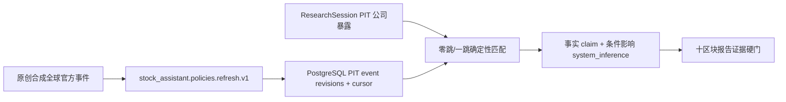
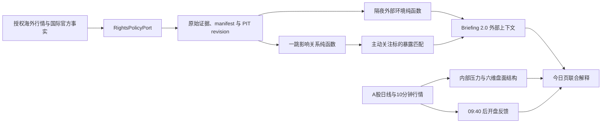

# R2 全球事件库与按需影响匹配框架

版本：2026-08-27
状态：统一 R2 合成实现；生产来源仍受四项 `PRODUCTION_*` 门禁阻断

## 当前架构结论

全球国际官方事件库与用户股票完全解耦：合成环境启动刷新一次，之后每 60 分钟刷新。刷新请求不得
包含 `instrument_id`、watchlist 或 active-target revision。事件复用现有 `market_events`、
`raw_documents`、`event_documents`、`event_entities`、`event_claims` 和 source cursor/run；
`MarketEventRepositoryPort 1.1` 兼容增加证券、公司、行业和地区任一结构化暴露面查询，1.0 读取保持不变。

创建 `ResearchSession` 后，worker 才组合 PIT 公司暴露和 `as_of` 可见的事件 revision。确定性匹配器只
允许官方直接点名、公司披露确认、证据一跳或行业背景，固定十二类影响渠道；两跳、新闻共现、匿名图和
模型常识全部拒绝。事件事实发布为 `fact`，对股票的条件影响发布为带输入/规则/截点/支持/反证的
`system_inference`。无相关事件可发布报告；库未刷新、过期或缺权必须形成不同 CoverageGap。



R2 不包含隔夜行情六块、08:55/09:05/09:40、个股通知、SSE 或后台关注股票。以下内容是重定界前的
历史规划档案，不是活动架构。

<details>
<summary>历史隔夜外部环境框架（不再活动）</summary>

## 1. 目标与架构边界

本框架把授权海外行情、国际官方事实、公司暴露和 A 股开盘反馈接入现有模块化单体，为一个主动关注
A 股生成外部上下文。外部环境属于事件与基本面轴，不改变交易结构压力公式。



不引入海外行情 Port、地缘事件 Port、影响计算 Port 或图数据库。跨时区状态和影响计算器都是领域纯
函数；任何新边界只有在真实调用方、适配器和契约测试同时存在时才落地。

## 2. 当前事实与规划项

| 项目 | 当前事实 | 本规划 |
|---|---|---|
| `Briefing 1.0` | 已发布 | 保留读取兼容；必需外部快照未来走 `Briefing 2.0` |
| `MarketEvent 1.0` | 已发布并承载事实 | 不把目标相关影响塞入事实 revision |
| `Watchlist` | 有 `alert_enabled` 与 revision 契约 | 应用用例约束恰好一个主动目标；持久化仍有接口缺口 |
| `PortfolioRepositoryPort` | 只支持 `PortfolioSnapshot` | 真实调用方出现后评审兼容扩展，不新建 Watchlist Port |
| `MarketDataRepositoryPort` | 仅 R4 文档中的 planned Port | 未来范围兼容覆盖宏观序列；当前不得称为已实现或已注册 |
| `BehaviorPressureRepositoryPort` | 仅 planned | 不保存外部快照，不改变其职责 |
| `governance/metrics.json` | 0 个真实指标 | 生产者落地后再登记，当前不预建 |

## 3. 复用的现有边界

未来实现优先复用：

- `SourceConnectorPort`：授权 provider 的原始获取；
- `RightsPolicyPort`：每次操作前失败关闭；
- `ObjectStorePort`：仅在允许保留时保存原始响应；
- `TradingCalendarPort`：A 股会话事实；海外会话通过同一边界或其兼容适配器校验；
- `MarketQuotePort`：适合正价格行情的查询，不承担负利率/利差；
- `MarketEventRepositoryPort`：保存外部事实事件和修订，不保存目标影响推断；
- `PolicySearchPort`、`PolicyMatchingPort`：国际官方规范性政策的检索与背景匹配；
- `BriefingGeneratorPort`、`BriefingRepositoryPort`：未来新版简报生成与留档；
- `MessagePublisherPort`、`UnitOfWorkPort`：事务 outbox 和变化提醒；
- `PortfolioRepositoryPort`：真实调用方出现后优先兼容扩展 Watchlist snapshot，而不是另建 Port。

本规划不会修改上述接口。尚未实现的 `MarketDataRepositoryPort` 仍只有在 R4/R2b 的共同真实调用方、
适配器和契约测试出现时才能创建。

## 4. 未来契约模型

### 4.1 `Briefing 2.0`

必需的 `OvernightExternalContextSnapshot` 会使已发布 `Briefing 1.0` 产生破坏性变化，因此未来采用
`Briefing 2.0`，保留 1.0 读取和迁移路径。新对象即使数据不足也必须存在，并使用
`ExternalContextState.INSUFFICIENT`，不能省略或让 LLM 补写。

### 4.2 事实、推断和反馈分离

- `MarketEvent 1.0` 继续只承载事实；
- planned `ExternalImpactLink` 引用 `event_id`、`evidence_id`、节点、渠道和暴露；
- planned `ExternalImpactAssessment` 引用主动目标/暴露/规则版本并承载条件化系统推断；
- planned `PostOpenFeedback` 引用冻结外部快照和 09:40 行情窗口；
- 这些对象作为 `Briefing 2.0` 的独立嵌套快照或独立关系记录，不驱动事实事件 revision。

不采用原计划中“`MarketEvent 1.1` 增加必需 `impact_links`”的写法。若未来确有通用关联查询需求，先
评审是否给 1.x 增加可选、默认空字段，或通过独立读模型表达；不得混淆事实修订和用户相关推断。

### 4.3 节点和宏观序列

- 不扩展当前与 `MasterDataQuery`/固定主数据快照绑定的 `EntityKind`；外部关系使用 planned
  `ImpactNodeKind`；
- planned `MarketSeriesObservationRevision` 支持有符号数值、变化、单位、会话窗口、
  `available_at`、`revision_known_at`、来源和 rights lineage；
- 正 OHLCV 继续复用 `MarketBar`/行情边界；负利率、利差和金融条件不得强塞入 `MarketBar`；
- `PolicyAuthorityLevel`、`PolicyTargetKind` 的国际组织/央行/商品/技术等枚举只在消费者兼容评审和
  契约测试后扩展，不能在规划阶段预写注册表。

新影响对象禁止 `probability`、`expected_return`、`buy_signal`、`sell_signal` 和单一 `confidence`。

## 5. 权利模型的未来扩展

当前 `RightsOperation` 尚无 `DERIVE`。`NON_DISPLAY` 是合同展示限制而非简单操作，`AI_USE` 又可能与
现有 `EMBED/TRAIN` 语义重叠。因此当前境外连接器保持禁用；未来必须基于真实合同原子更新：

1. 契约中的操作与用途维度，至少明确 `DERIVE`；
2. 来源配置与权利检查器；
3. 运行时策略、manifest 和 rights snapshot；
4. 生产者/消费者、schema、接口注册表、测试与文档；
5. 如合同区分展示和模型输入，再定义清晰的 `DISPLAY_DERIVED`/`LLM_INPUT` 等语义。

只有 `FETCH + RETAIN + DERIVE` 及合同要求的派生展示/模型用途均明确允许时，真实数据路径才可启用。

## 6. 任务、调度与幂等

不新建任务名：

- 复用 `stock_assistant.ingestion.premarket_ingest.v1`；其 R1 v1.0 request/result 已冻结，外部窗口字段
  只能在真实消费者出现时按兼容 minor Schema 演进，不能静默改写 v1.0；
- 复用 `stock_assistant.policies.refresh.v1` 发现国际组织、央行、制裁和出口管制官方来源；
- `premarket_ingest` 当前校验强类型 request 后返回 typed `SKIPPED`；`policies.refresh` 仍只保留名称、
  禁止调度并失败关闭。未来实现必须同步 callable、producer、consumer、Schema、注册表和契约测试；
- 09:40 反馈属于未来 10 分钟行为计算流程，不把 `premarket_ingest` 扩义成开盘后任务。

计划幂等键：

```text
active_target_revision
+ observation_cutoff
+ source_manifest_hash
+ exposure_profile_version
+ rule_version
```

同一窗口重放 100 次最多产生一份外部快照、一份对应简报 revision 和一条待发布 outbox；晚到或更正
数据因 manifest/revision 改变形成可追踪新版本。

## 7. 数据与存储职责

| 数据 | 规划存储 | 不变量 |
|---|---|---|
| 原始 provider 响应 | SeaweedFS | 只有 `RETAIN` 允许时写入；内容 hash 和 rights snapshot |
| 海外日线/会话/连续市场切片 | 版本化 Parquet | 不原地重写；manifest 指向数据版本 |
| 宏观有符号序列 | Parquet＋PostgreSQL revision 元数据 | 单位、会话、可见时间和来源 lineage |
| 外部事实和证据 | PostgreSQL 双时态表 | 事实修订与推断修订分离 |
| 一跳暴露关系/影响评估 | PostgreSQL 关系表 | PIT、证据、directness、规则和 supersedes |
| 外部快照/开盘反馈 | PostgreSQL | 冻结窗口和引用；追加修订 |
| 最新简报缓存 | Valkey | 可重建，不是事实或提醒状态主存储 |

一跳图采用普通关系表和递归深度约束，不引入 Neo4j。原始数据无保留权时只保存合同允许的派生结果、
manifest 元数据和审计证明。

## 8. 读模型与页面边界

前期不新增独立外部环境 HTTP。外部快照作为盘前简报与“今日”聚合读模型的一部分返回；出现真实的
独立历史查询用户需求后，才评审公共集合资源。

页面只消费服务端已计算状态、路径和质量信息。前端不得自行选择相关海外证券、重算异常分位、净额
相抵支持/反证、生成公司影响或跨模式比较。

## 9. 与交易结构能力的隔离

- 外部观测不写入压力五分面或十贡献簇；
- 外部快照不保存在 `BehaviorPressureRepositoryPort`；
- 六维盘面结构中的“相对环境”可引用已验证的外部支持/反证，但其 A 股行业/市场状态仍独立计算；
- 历史相似情景只有在离线验证通过后才可用外部状态做筛选，不能改写已冻结压力分数；
- 开盘反馈事件明确为 `system_inference`，不能伪装成 `MarketEvent` 事实。

## 10. 本轮治理结论

本轮只写文档和目录职责：

- 不修改 contracts、ports、schema、migrations、task 实现或 schedules；
- 不修改 `governance/interfaces.json` 或 `governance/metrics.json`；
- 不安装 exchange_calendars/sdmx1，不修改依赖锁；
- 已新增复用调研记录并同步机器可读决策和 `THIRD_PARTY.md`；
- 实现时必须按规范事实源→契约→迁移→生产者/消费者→注册表→测试→文档的顺序同步。

</details>
