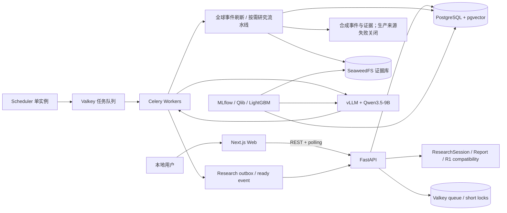
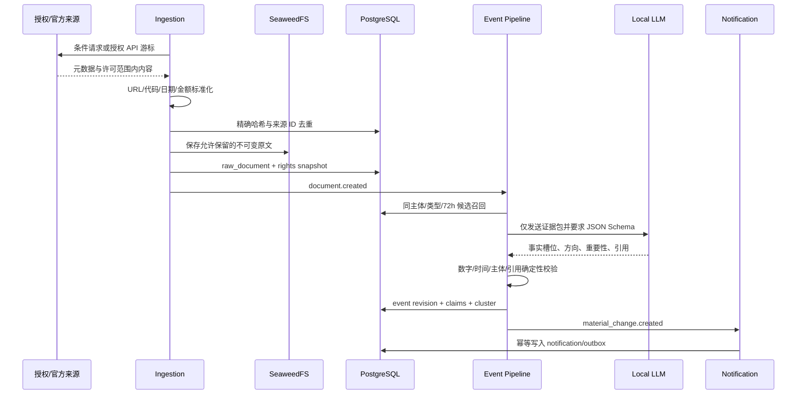

# 系统架构设计

## 1. 架构结论

采用 **模块化单体 + 多进程运行**：业务能力放在一个有清晰边界的 Python 包中，API、任务 worker、
调度器分别启动，前端独立构建。PostgreSQL 是事实主库，Valkey 只做短时状态和队列，SeaweedFS 只存
不可变证据与模型产物。

目标组件由 2026-07-22 开源审计确定。R0P Compose 已替换为固定镜像的 Valkey/SeaweedFS；这只证明
目标服务进入开发运行时，不代表生产 adapter、对象版本/校验、备份恢复或真实证据写入已通过。下图
描述目标架构，实际成熟度仍以 `governance/delivery.json` 为准。

这不是临时原型。它刻意避免第一天引入 Kafka、Kubernetes 和多个数据库，同时保留 outbox、幂等键、模块契约和 point-in-time 数据，使后续可以按真实负载拆服务。

## 2. 总体结构



## 3. 进程职责

### Web

负责 A 股搜索与确认、研究阶段轮询、十区块完整报告、国际事件影响路径、证据下钻、七日历史和删除。
R1 固定目标页面只作兼容。浏览器不直接接触数据源密钥、数据库或模型端点。

### API

负责参数校验、研究会话事务、状态/报告读取、取消/重试/删除和审计。API 不执行耗时采集、匹配、
embedding 或模型生成，也不提供 R2 SSE/通知。

### Worker

执行 stock-agnostic 全局事件刷新和 `stock_assistant.research.generate_report.v1`。研究 worker 组装 PIT
数据包、运行零跳/一跳匹配、调用模型叙事、执行确定性发布校验并原子持久化报告/claim/ready event。
任务必须可重试，副作用以数据库唯一约束、事务 outbox 和幂等键保护。

### Scheduler

只运行一个 scheduler：启动并每 60 分钟调度 stock-agnostic 全球事件刷新，relay 研究 outbox，并执行
30 分钟停滞看门狗和七日清理。R1 fixture 开关启用时才运行冻结盘前兼容任务；R2 不调度用户股票。

### 本地模型服务

vLLM 作为独立 GPU 进程，暴露 OpenAI-compatible API。生产 adapter 启动时静态挂载，禁止从未经验证的路径动态加载。模型故障不会阻塞原始证据持久化。

## 4. 领域模块与依赖方向

```text
contracts/common
      ↑
    ports
   ↑    ↑
modules  platform adapters
   ↑      ↑
   apps/bootstrap

领域关系：

instruments  portfolio  ingestion
      ↑          ↑          ↑
policies      events ←───────┘
      ↑          ↑
sectors      memory
      ↑          ↑
briefings   chat   forecasting
      └──────┬──────┘
         notifications
```

- `contracts` 不依赖业务模块；它定义稳定 API、事件和消息结构。
- `ingestion` 只产生文档与候选事实，不给买卖建议。
- `events` 拥有聚类、修订和事实槽位；向量相似只是候选召回。
- `memory` 拥有检索策略，不拥有源采集。
- `forecasting` 读取 point-in-time 特征和事件，不生成解释文本。
- `notifications` 只消费已验证的物化变化。
- `platform` 实现数据库、缓存、对象存储、模型和安全适配器，领域模块只依赖端口。

上图箭头表示“调用/依赖指向被依赖方”，不是部署流向。可执行允许列表以
`governance/architecture.json` 为准：platform 可以引用公开 application/domain 类型来完成映射和
adapter 组装，但不能反向拥有业务规则，也不能成为跨 bounded context 访问内部实现的捷径。

### 4.1 分布式研发边界

模块化单体允许多个工作包并行，但公共内核与集成热点不能多写。`governance/delivery.json` 固定阶段
DAG、单写区和唯一活动执行；`docs/engineering/parallel-development-protocol.md` 固定契约冻结与合并
顺序。领域、来源、基础设施和消费者 lane 只在公共契约冻结后从同一提交分叉，组合根、迁移、任务
目录和最终 E2E 由指定 Steward 串行整合。这一研发拓扑不会改变运行时模块语义。

## 5. 数据摄取流水线



### 失败处理

- 来源失败：游标不前移，连接器退避并记录数据缺口。
- SeaweedFS 失败：禁止把带全文的 document 标记为已完成。
- LLM 失败：文档保留在待抽取队列，不生成空事实。
- JSON/引用校验失败：最多两次修复重试，仍失败则进入人工复核队列。
- 通知失败：outbox 保留并重试，不重新创建事件。

## 6. R2 统一工作流

1. scheduler 生成无证券字段的事件刷新请求；同来源、小时桶和 manifest 重放幂等；
2. worker 将原创合成事件写入现有 evidence/event revision 链，失败事务不推进 cursor；
3. 用户搜索并确认证券；API 原子创建 `ResearchSession` 与 job outbox。请求未传 `as_of` 时记录 `current_run` 和会话创建截点，显式 `as_of` 时记录 `historical_replay`，未来时间拒绝；
4. worker 构建五年/二十季度/上市以来的 PIT 公司 evidence packet 和暴露档案，并先记录内置 API 的明确缺口；
5. 只有当前研究的证据包已记录必需业务字段缺失时，DeepSeek 才生成无 URL 的结构化查询计划；Tavily 每个查询只发现最多五个候选 URL，URL hostname 必须与候选 domain 和登记来源一致，权利和受控 connector 再决定是否取证。历史研究禁止实时发现；原始页面始终为 `INELIGIBLE`，只有与已获取正文中连续摘录精确绑定、且数值与单位可确定性回查的事实才能晋升为证据；
6. 读取截至会话 `as_of` 可见的全球事件 revision 和 catalog watermark；确定性匹配器只接受零跳/一跳证据路径；
7. 项目适配的 20 个分析方法和一个投资备忘录写作层驱动 DeepSeek 结构化判断，模型不直接读取上游自由文本；
8. 程序按六维权重、事实覆盖、PIT、单位、来源独立性与单源向中性收缩规则计算评分和证据可信度。历史研究的 `as_of` 固定不变；当前研究只接纳发布日期和已知修订时间不晚于初始截点、且真实首次观测时间不晚于任务期限的网页，并把最终 `as_of` 推进到全部已接纳 citation 的最晚 `first_seen_at`；
9. DeepSeek 只组织十区块叙事、Bull/Bear、未知项、可证伪条件和通俗改写；服务器从强类型字段编译安全 Markdown；
10. 专业版、易读版、scorecard、方法回执和联网披露全部校验成功后，仓储在同一事务内核对持久化任务模式、期限和当前 job，再原子同步发布报告及会话 `as_of`/缺口；七日后清理会话内容与联网标识。

私有 Web 预览在兼容的 `/api/v1` 之外发布认证隔离的 `/api/v2` 镜像接口。Cognito access token 在
`AuthorizationIdentityPort 1.1` 后严格校验 RS256、issuer、client ID、`token_use`、时间和 JWKS；
数据库只存外部 subject 的 SHA-256 所有者标识。用户池关闭 MFA，页面只呈现用户名和密码；密码仍由
Cognito 验证，StockMarketAgent 后端不接收或保存密码。v2 的列表、读取、报告、取消、重试与删除全部按所有者
过滤，跨用户访问统一表现为不可枚举 404。浏览器配置是无密钥的 `RuntimeWebConfig 1.0`。

AWS 私有合成预览复用已验证的 CloudFront/私有 S3 外壳，并以独立
`stockmarketagent-r2-preview` 栈承载 RDS、TLS Valkey、研究制品 S3、ECR、ECS API/worker/scheduler 和内部受控出口代理、
WAF、日志和告警。ALB 同时要求 AWS-managed CloudFront origin-facing prefix list 与项目专属、由
Secrets Manager 动态引用注入的 origin verification header；默认 listener 返回 403。运行服务先以零副本
创建并执行同一 SHA/镜像摘要的迁移，迁移回执通过后才激活运行服务。DeepSeek 和 Tavily Secret 只进入
worker；worker 无直接公网 HTTPS 出口，外部访问必须经过按域名限制的 CONNECT 代理。

## 7. R1 兼容与后续边界

R1 的 `XSHG:603986`、`active_target` 和盘前任务冻结兼容，R2/R3/R4 不继承。R3 只做研究会话内证据
问答、解释和有限历史比较；R4 只在创建研究时生成一次 PIT 市场结构快照。两者都不恢复今日页、
watchlist、十分钟监控、09:40 反馈、通知或 SSE。

## 8. 对话与 Agent 编排

LangGraph 用于有限状态图，不采用无边界多 Agent 自由讨论。节点固定为：

```text
intent → authorization → retrieve → evidence_pack → generate → verify → render
                           ↘ insufficient/conflict → abstain
```

工具按任务白名单开放：证券查询、事件查询、政策查询、预测回溯和系统健康。网页文本中的“忽略指令”“调用工具”等内容均视为数据，不进入 system/tool 消息。任何最终事实必须映射到 `event_claims` 或许可证据。

上游 TradingAgents 的角色编排只在独立研究适配器中参考，不让其直接读取生产数据库、推送通知或生成真实交易。

## 9. 数据与时间语义

所有外部事实至少记录：

- `event_time`：事件实际发生时间；
- `published_at`：来源声明发布时间；
- `first_seen_at`：系统第一次获得信息的时间；
- `fetched_at`：本次抓取时间；
- `valid_from/valid_to`：数据库事实版本有效期。

在线查询按最新有效版本读取；历史回测必须同时满足 `first_seen_at <= decision_time` 和映射的 `valid_from <= decision_time < valid_to`。报告期末日期不能代替财报实际披露时间。

R2 全球事件查询与公司暴露都必须满足 `revision_known_at <= ResearchSession.as_of`。事件事实 revision
长期追加；股票匹配、方向推断、报告上下文和 embedding 绑定 `session_id + expires_at`，后来 revision
不得改写已发布报告。R4 的一次性市场结构快照同样只读 `available_at/revision_known_at <= as_of` 的行情、
股本、公司行为、交易规则和行业映射。

## 10. 存储分工

| 存储 | 内容 | 不能存 |
|---|---|---|
| PostgreSQL | 业务事实、实体、事件 revision、研究会话/报告/claim、短期匹配、审计、权利快照 | 大模型权重、海量原文二进制 |
| pgvector | 许可文档切片和七日会话 embedding | 唯一事实判定、长期个股记忆 |
| Valkey | 任务队列、限流、锁、relay 和短时去重 | 永久事实、报告正文、长期语义记忆 |
| SeaweedFS | 许可原文、PDF/JSON、数据 manifest、adapter、模型和报告产物 | 明文密钥；无 `RETAIN` 权利的外部响应 |
| Git | 代码、schema、规则、配置模板、小型脱敏金标样例 | 持仓、token、授权全文、模型权重 |

## 11. API 边界

已实现的 R1 兼容和 R2 公共 HTTP 以 OpenAPI 与 `governance/interfaces.json` 为唯一机器事实。
主要资源为：

```text
GET        /api/v1/active-target
PUT        /api/v1/active-target
GET        /api/v1/briefings/premarket/latest
GET        /api/v1/events/{event_id}/evidence
GET        /api/v1/instruments/search
POST/GET   /api/v1/research-sessions
GET        /api/v1/research-sessions/{id}
GET        /api/v1/research-sessions/{id}/report
POST       /api/v1/research-sessions/{id}/cancel
POST       /api/v1/research-sessions/{id}/retry
DELETE     /api/v1/research-sessions/{id}

GET        /api/v2/instruments/search
GET        /api/v2/instruments/directory-search
POST/GET   /api/v2/research-sessions
GET        /api/v2/research-sessions/{id}
GET        /api/v2/research-sessions/{id}/report
GET        /api/v2/research-sessions/{id}/report-v1.1
POST       /api/v2/research-sessions/{id}/cancel
POST       /api/v2/research-sessions/{id}/retry
DELETE     /api/v2/research-sessions/{id}
```

长任务返回 `202 + job_id`；R2 客户端轮询强类型会话状态。原 `/report` 继续投影不可变的
`ResearchReport 1.0`；新 Web 使用并列的 `/report-v1.1` 读取易读版、六维评分、方法回执和联网披露，
避免以响应版本替换破坏旧客户端。REST 和事件契约在删除或重命名字段前必须升主版本。

### 11.1 国际影响与后续快照

全球事件刷新和按需匹配不新增公共 HTTP。国际影响通过 `ResearchReport 1.0/1.1` 的强类型 claim、
calculation inputs、evidence 和 counter evidence 返回，前端不得解析自由文本推导方向。R4 的一次性
PIT 市场结构快照在真实消费者和兼容契约冻结前也不预登记新 HTTP。

## 12. 扩展策略

只有满足可测触发条件才拆服务：

- 采集队列 p95 等待超过 60 秒且增加 worker 不能解决时，拆 `ingestion`；
- embedding/GPU 任务阻塞简报 SLA 时，拆 `intelligence` 队列和资源池；
- 行情写入超过 PostgreSQL 单机预算时，才引入专门时序存储；
- outbox 每秒事件达到 Valkey 队列无法稳定处理的量级时，才评估 RabbitMQ/Kafka/Redpanda；
- 只有需要多机编排、滚动升级和 GPU 调度时才引入 Kubernetes。

模块契约、outbox 和独立进程使这些拆分不改变业务语义。

R3 复用 ResearchSession、报告和 evidence bundle 做会话内问答，不建立 inbox/SSE/通知。R4 的一次性
快照保持确定性纯函数并复用研究报告 claim 边界；不新建行为通知 Port。全球事件继续由 PostgreSQL
现有表表达，不新建海外行情 Port、地缘事件 Port 或图数据库 Port。

## 13. 关键技术决策

- PostgreSQL + pgvector 代替独立向量库，减少一致性和备份复杂度。
- Celery + Valkey 负责个人单机任务；每个任务通过数据库幂等和 outbox 保证语义。
- Qwen3.5-9B 平衡中文、结构化输出、许可证和 24GB 单卡可行性。
- LightGBM 先于深度时序网络，因为数据规模、非平稳性、可解释性和校准比模型新颖度更重要。
- Next.js 只做呈现与交互；所有金融规则留在后端。

对应 ADR 见 `docs/decisions/`。
