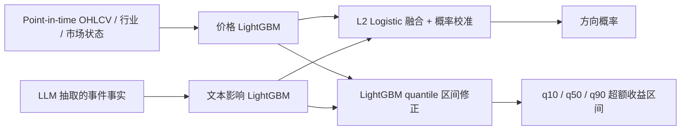

# 时序量化、文本影响与 LLM 融合

## 1. 科学假设

待验证假设是：价格/量能包含可重复的短期统计信号，新闻和政策包含量价无法提前反映的事件信息；将两者的严格样本外预测做校准融合，可能优于任一单分支。

这是实验假设，不是“融合后准确率一定更高”。若融合未通过闸门，产品仍可发布事实简报，但不显示方向概率。

## 2. 唯一建模路线

LLM 不输出最终概率，不自由覆盖价格模型。它只生成经过引用校验的事件特征。

## 3. 第一版预测定义

- `decision_time`：交易日 09:20；
- 假设入场价格：09:30–09:35 VWAP；
- 预测终点：当日收盘；
- 回归目标：个股收益减去当时有效申万一级行业收益，再扣估计交易成本；
- 分类目标：净超额收益是否大于 0；
- 输出：`P(excess_return > 0)` 与 q10/q50/q90 区间；
- 用途：研究展示，不产生订单或仓位。

盘中 10 分钟轮询第一阶段只更新事件和风险警报。只有累计足够分钟级 point-in-time 样本后，才按相同流程建立“未来 30 分钟超额收益”独立任务，不能拿日频模型直接套用。

## 4. 价格分支

使用 Qlib 管理数据/特征/回测工作流，模型是 LightGBM。

### 特征

- 前复权 OHLCV 与多周期收益；
- 真实可得的复权因子版本；
- 成交额、换手率、量比、振幅；
- 实现波动率、偏度、跳跃和量价背离；
- 5/10/20/60 日相对动量与反转；
- 行业相对收益、行业广度和市场指数状态；
- 流动性、停牌、ST、涨跌停可交易性；
- 历史时点市值/估值，仅在授权和实际可得时加入。

所有 rolling 特征在 `decision_time` 前截断，窗口计算显式 `shift(1)` 或以可得分钟为边界。预处理器、缺失值、winsorize、标准化和特征选择都在每个训练窗口内部拟合。

### 输出

- 二分类 LightGBM 输出 `p_quant_raw`；
- 三个 quantile objective 模型输出价格分支 q10/q50/q90；
- 单调性检查确保 q10 ≤ q50 ≤ q90，违反时拒绝发布并记录错误。

## 5. 文本影响分支

输入只来自 `market_events` 和 `event_claims`，不能把 LLM 自由文本 embedding 直接当不可解释结论。

### 聚合窗口

分别聚合截至 09:20 的 1、6、24、72 小时特征：

- 事件类型、状态、方向、影响期限；
- 来源权重、质量分、重要性、置信度和新颖度；
- NEW/UPDATE/CORRECTION/CONTRADICTION 数量；
- 交叉印证源数量和冲突数量；
- 金额/市值、订单/营收、减持/总股本等可比较比例；
- 新闻时间衰减；
- 公司、行业、政策层事件分别计数；
- 源缺失和数据延迟作为显式特征。

文本 LightGBM 输出 `p_text_raw`。生成训练特征时冻结本地模型、adapter、prompt 和规则；对训练期做 out-of-fold 抽取/预测，禁止同一标签信息反哺抽取器。

## 6. 融合与校准

方向融合使用 L2 正则 Logistic Regression，输入仅包括两个分支的 OOF 概率、市场状态和数据质量标志。基础模型训练、融合训练和概率校准使用互不重叠的时间段。

校准采用 sigmoid calibration；只有样本量和可靠性图证明必要时才能改动方法。收益区间使用独立 LightGBM quantile 修正模型，输入价格分支区间、文本事件聚合和市场状态。

若某一分支缺失，模型不能静默填 0：使用训练时定义的 missing flag 与缺失处理；超出训练分布则降级为不发布预测。

## 7. 滚动样本外设计

严禁随机切分：

1. 训练窗口：向前扩展，首个窗口至少 3 年；
2. 超参验证：接下来 3 个月；
3. 概率校准：再接下来 3 个月；
4. 测试：再接下来 3 个月；
5. 每季度向前滚动；
6. train/test 之间 embargo 5 个交易日；
7. 最新 6 个月只在最终决策时开启一次。

股票面板使用按交易日分组的 purged splitter。相同事件簇、重叠标签和修订链不能跨训练/测试；转载先聚类再划分。

## 8. 泄漏与偏差清单

- 使用历史时点指数/行业成分，包含退市股，避免幸存者偏差；
- 财报以实际披露和 `first_seen_at` 入特征，不以报告期末入特征；
- 复权因子、行业、公司地区和交易规则均按当时版本；
- 不用今天的大模型知识为历史事件编写预测理由；
- 外部 API 模型不能生成回测特征，因为版本会漂移且训练知识不可控；
- 每个窗口内重新拟合 scaler、缺失值、阈值、特征选择和模型；
- 计入当时适用的佣金、印花税、滑点、涨跌停无法成交、停牌、T+1 和流动性；
- 以假设成交 VWAP 而非不可成交的开盘价计算结果；
- 所有数据记录 vendor revision 和 feature snapshot hash。

## 9. 评估

### 概率与区间

- Brier score、log loss、ECE 和可靠性曲线；
- q10–q90 coverage、pinball loss 和区间宽度；
- 按置信度分桶的实际胜率，不只报全局准确率。

### 排序与经济意义

- 日度/行业内 Rank IC 与 ICIR；
- 只用于研究组合的扣费后收益、Sharpe、最大回撤、换手率；
- 分行业、公司规模、牛熊/震荡、公告类型和数据质量分层；
- 价格单模、文本单模、融合模型消融；
- 交易日 block bootstrap 95% 置信区间。

50% 左右方向准确率不等于无效，较高准确率也可能来自类别不平衡。因此不把 accuracy 设为唯一上线指标。

## 10. 上线闸门

融合模型要进入 60 日纸面运行，必须同时满足：

1. 在绝大多数滚动窗口中，Brier 和 log loss 均不劣于两个单分支；
2. 相对最佳单分支的综合概率指标提升在 block bootstrap 下具有稳定正向证据；
3. ECE ≤ 0.05，可靠性曲线无系统性过度自信；
4. q10–q90 的实际覆盖率位于 75%–85%；
5. 扣费后表现没有由极少数日期、行业或不可成交股票贡献；
6. 最大回撤、换手和数据缺失在预设风险预算内；
7. 泄漏、数据权利、可复现和模型卡检查全部通过。

纸面运行至少 60 个交易日，期间模型、规则和阈值冻结。漂移或重大数据缺口触发计时重置。通过后也只在 UI 展示“概率区间与证据”，真实交易保持关闭。

## 11. 漂移与再训练

- 每日监控特征 PSI、事件类型分布、缺失率、概率分布和校准残差；
- 每周检查源覆盖、行业表现和数据延迟；
- 每月生成 champion/challenger 报告；
- 每季度按滚动窗口训练候选，不能自动替换 champion；
- 发生交易规则、行情源、行业分类、模型/adapter 或事件 schema 变更时强制新 major dataset/model version。
