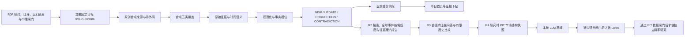

# StockMarketAgent 完整实施路线图

<!-- r1-product-scope:v2 -->

R1 唯一定义：**固定标的兆易创新（`XSHG:603986` / `603986.SH`）＋原创固定合成数据＋零外网＋
五类覆盖、多源冲突和可下钻简报的完整产品链路**。

## 当前阶段进度（2026-09-09）

R0P及R1合成闭环有历史验证；R2会话、报告与恢复已实现，私人真实入口已部署，但真实资料至独立审核/报告链路未通过验收。原五项及两项定向研究全部失败、零报告；最新修复本地门禁通过但发布被宿主hook阻塞。R3–R6仍按后续规格推进，不把规划组件或声明接口写成已完成。

精确SHA、来源与样本限制、验证/部署状态和当前阻碍只在当前任务 (upstream private record, excluded)与delivery登记 (upstream private record, excluded)维护。本路线图描述阶段顺序，不另建滚动进度副本。

## 1. 目标与唯一实施顺序

当前首要产品闭环是：**搜索并确认一只沪深北 A 股，创建独立研究会话，回溯五年主窗口、二十季度和
上市以来重大事件，从与用户股票解耦的全球国际官方事件库按需匹配，由模型组织多视角研究，再由
确定性证据硬门一次性发布完整报告。**

唯一实施顺序为 R0 → R0P → R1 → R2 → R3 → R4 → R5 → R6。R0P 只建立安全并行交付基础，
不实现产品能力。后续阶段可以继续积累合规数据，但不得绕过前一阶段的质量闸门，也不得用交易结构
分数、LLM、LoRA 或量化模型掩盖来源、时间或事件正确性问题。

项目继续保持单用户、本机、研究与纸面验证属性，不接入真实下单，不承诺收益。按一名全职工程师估算，
R0–R6 功能开发约 28 周，之后至少运行 60 个交易日的冻结纸面验证；实际进度由数据授权、硬件和阶段
闸门决定，不以日历强行放行。

## 2. 当前基线与约束

### 已有基础

- 模块化单体目录、API/worker/scheduler/Web 入口和分层门禁；
- canonical event、briefing、notification 等强类型契约；
- 数据来源权利、point-in-time、事件比较、来源评分和任务配置基础；
- Agent 强制入口、接口/指标注册表、复用优先和完整 `make verify` 门禁；
- 当前Web已有登录、股票研究、历史、完整/部分报告与证据下钻；运行入口和本地测试存在不等于真实资料验收。各Port/任务真实成熟度按注册表与运行证据判定。

### 不可跨越的约束

1. 真实数据必须通过当前阶段来源策略；R1–R6仅使用所有者已登记来源并标记DEV_ONLY/UNVERIFIED，正式生产/R7授权仍失败关闭。失败不得用合成事实补位。
2. 事实、系统推断和概率预测分别表达；事实必须可回溯到 `evidence_id`。
3. 历史简报只读取 `first_seen_at <= decision_time` 且当时有效的版本。
4. 同一公告、revision 和通知必须幂等；更正保留旧版本和完整证据链。
5. 先检索 `governance/interfaces.json` 与 `governance/metrics.json`；禁止重复或推测性新增。
6. 新能力先按 `docs/engineering/reuse-first-policy.md` 调研成熟、许可清晰的实现；自研只填补记录明确的领域缺口。
7. R0P Compose 已使用 Valkey/SeaweedFS，但真实证据写入仍必须先完成目标适配器、对象完整性和恢复验证。

### 2.1 分布式交付模型

路线图阶段不能直接等同于并行工作包。`governance/delivery.json` 是阶段依赖、交付状态、能力所有权、
单写区和唯一活动执行的机器事实源；`docs/engineering/parallel-development-protocol.md` 定义契约冻结、
轻量工作包、worktree 和串行 integration。

每个阶段先由 PAE 冻结公共边界和 API Contract Pack，再把数据、来源、后端用例、前端与量化拆成
写范围互斥的短包，最后由 QIR 串行完成组合、集成、E2E 和恢复。公共契约、迁移、Web、runtime、
依赖锁和发布状态始终单写。

R0P 已完成。主动标的与两个 R1 任务契约已经冻结，追加式迁移、任务/调度边界、真实 PostgreSQL
恢复、完整栈 smoke、四 worktree 隔离、本地完整门禁、云端 CI 正反传播、历史远端引用回读和隔离
revert 演练均已验证。R1 现在只以原创 fixture 驱动的
Web→API→scheduler/dispatcher→worker→PostgreSQL/Valkey/对象存储→Web 产品 E2E 为出口证据；
真实来源授权与 live E2E 已移至正式发布门禁。
旧 strict_hs/v2 execution 只读保留，后续新包使用六部门轻量协议。远端发布证据不
阻断本地开发，只阻断远端 main/tag 正式发布。
R1 合成产品 E2E 是其唯一产品出口证据，不代表生产就绪。

### 2.2 六部门责任域与短生命周期分支

虚拟部门是长期责任域，不是长期 Git 分支。每个工作包从共同冻结提交创建一条短生命周期独立分支，
按具体制品建立短生命周期包；默认角色为实现、独立审查和发布。完成集成后停止写入并销毁本地环境，
普通远端分支删除且不创建 package tag。固定责任域如下：

| 代码 | 长期责任域 | 主要范围 |
|---|---|---|
| PAE | 产品与架构标准部 | 产品范围、contracts、Ports、Schema、OpenAPI、接口/指标和契约包 |
| DMI | 数据与市场情报部 | 来源权利、证据、事件、政策、PIT、Repository、迁移与恢复 |
| BAE | 助手后端应用部 | 主动标的、memory、briefings、聊天、notifications 与薄 handler |
| FEX | 前端产品体验部 | `apps/web` 页面、组件、响应式、无障碍和个人深度定制 |
| QMR | 量化与模型研究部 | 压力、盘面诊断、历史情景、模型/LoRA 与 walk-forward |
| QIR | 质量、运行与集成部 | 组合根、worker、调度、依赖锁、CI、integration/E2E 与发布 |

公共契约、迁移、Web、依赖锁/runtime、全局集成环境和发布状态分别由 PAE、DMI、FEX、QIR 单写。
QIR 是唯一可将工作包以 `--ff` 串行纳入 integration，
并在候选通过后以 `--ff-only` 推进本地 `main` 的角色；不得在 `main` 生成第二个 merge commit。
该组织结构已用于 R1 第一波短包和 QIR 串行 integration。当前普通任务只读取
`governance/delivery.json.ordinary_delivery`；旧 `active_execution` 只存在于 Git 历史。

## 3. 里程碑总览

| 阶段 | 估算 | 用户可验证结果 | 进入条件 | 退出标记 |
|---|---:|---|---|---|
| R0 | 已完成 | 五分钟内得到环境诊断或合成盘前简报 | 当前工程基线通过 | `v0.2.0-calibrated` |
| R0P | 已完成 | 四个独立 worktree 可安全并行，契约与迁移不能静默漂移 | R0 验证、治理基线可追溯 | `v0.2.1-parallel-foundation` |
| R1 | 已完成（合成环境） | 固定兆易创新、合成五类覆盖、多源冲突和可下钻简报 | R0P 已通过；合成全栈与恢复通过 | 未发布，不创建 tag |
| R2 | 进行中（合成环境） | 搜索一只 A 股、全球事件按需匹配、阶段进度和十区块证据报告 | R1 合成正确性和恢复通过 | 未发布，不创建 tag |
| R3 | 后续 | 会话内证据问答、报告解释和有限历史比较 | R2 PIT、报告与七日生命周期通过 | 未发布，不创建 tag |
| R4 | 后续 | 用户发起研究时生成一次 PIT 市场结构快照 | R3 会话解释与行情 PIT 输入通过 | 未发布，不创建 tag |
| R5 | 第 21–24 周 | 本地模型可审计生成；通过闸门后才训练 LoRA | 金标与基础模型错误分析完成 | `v0.7.0-grounded-llm` |
| R6 | 第 25–28 周 + 60 交易日 | 独立 PIT 概率研究、融合和冻结纸面验证 | 足量 PIT 数据和稳定文本生成器 | `v0.8.0-research` |

每阶段的 decision-complete 任务、测试顺序和降级路径以 [`workstreams/README.md`](workstreams/README.md) 下的独立规格为准；该目录是本路线图的分解，不另建产品事实源。

## 4. R0：方案校准与环境闸门

### 交付

- 以本路线图替换“先铺满基础设施和接口、后得到用户反馈”的旧顺序；
- 提供 `make doctor`，检查 Python、Node、npm、Docker Compose、uv、仓库锁文件和硬件路径；
- 提供 `make demo`，只使用确定性合成证据展示更正、来源缺口、PIT 与 LLM 离线降级；
- 建立体验设计规范和开发者体验规范；
- 把“先明确成功条件、独立规格、失败测试、最小实现、新鲜验证”写入现有 Agent 修改协议；
- 确认 Valkey、SeaweedFS、数据权利、密钥管理和训练/推理硬件 spike 的进入闸门。

### 退出条件

- 新环境五分钟内能得到明确成功输出，或得到包含原因和修复动作的失败结果；
- 合成 demo 不访问网络、不读取 `.env`、不包含真实持仓或私有数据，不依赖 LLM；
- 本轮不新增公共接口、Port、Schema 或统一指标；
- `make verify` 完整通过。

## 5. R0P：并行交付基础

### 范围

1. 冻结 `PortfolioRepositoryPort 1.1` 的主动标的读写边界和四个 R1 任务 request/result schema；
2. 只增不改地对齐稳定 event identity、八状态 job ledger、事务 outbox 和技术 inbox；
3. 让两个 R1 task 只接受完整 request 并以 typed `SKIPPED` 失败关闭，四个延期 task 明确禁用；
4. 以真实路径 hash 生成 Compose project 名，隔离端口、网络、卷、数据库、缓存和对象；
5. 把治理、Python、Web、迁移、真实基础设施集成、E2E harness 和四槽隔离拆成独立 CI 检查，
   最后由稳定的 `quality-gate` 汇总；
6. 以 `make contract-compat` 比较合并基线，拒绝修改历史迁移、已发布 schema 和冻结 Port；
7. 保留历史远端验证；治理 v2 后这些事实只作为 release gate，不再作为产品开发进入条件。

### 退出条件

- 四个 worktree 同时运行且精确销毁一个不会影响另外三个；
- event/job/outbox/inbox 迁移在真实 PostgreSQL 通过升级、PIT、重放和恢复测试；
- 两个 R1 task 拒绝零参数调用，延期任务不进入 Beat；
- CI 分层检查和 `quality-gate` 的失败传播经过实际验证；
- 远端集成推送的分支、提交与祖先关系具有可回读证据；
- 新鲜 `make verify` 完整通过。

R0P 不实现来源连接器、R1 API/Web、外部市场、压力指数、LLM、LoRA 或量化能力。详细规格：
[`r0p-parallel-delivery-foundation.md`](workstreams/r0p-parallel-delivery-foundation.md)。

## 6. R1：盘前纵向闭环

### 范围

1. 加载固定标的 `XSHG:603986`（`603986.SH`，兆易创新），首次建立 revision 1，重复加载幂等；
   任意其他证券在网络 I/O 前以 `R1_TARGET_LOCKED` 失败；
2. R1 候选只加载原创固定合成 fixture；所有真实 capability 在任何网络 I/O 前失败关闭；
3. 真实来源 adapter、rights snapshot 与 live E2E 延期到正式发布门禁；
4. 保存不可变原始证据、hash、rights snapshot、发布时间、首次发现时间和修订已知时间；
5. 对法定公告、财务变化、行情快照、公司与行业新闻、相关宏观快讯五类分别生成覆盖状态；
6. 规范化事实槽位，通过 `EventRevisionPort` 产生 NEW/UPDATE/CORRECTION/CONTRADICTION；同一事实
   保留全部 `evidence_id`，冲突不得平均或覆盖；
7. 保存两个来源各自的上次成功游标，使用 `BriefingGeneratorPort` 生成盘前差异简报；
8. 复用 `JobDispatcherPort`/`SchedulerPort` 落地 08:55 摄取与 09:05 简报调度；每次 firing 创建新的
   `JobRequest`、`as_of`、correlation 和稳定业务幂等键；
9. 只交付固定目标 GET、最新简报 GET 与 evidence GET，以及今日首页和跨进程 E2E；R1 不实现
   搜索、输入、添加、用户激活、删除、切换或 `PUT /api/v1/active-target`。

### R1 并行波次（execution implementing）

1. **W0 PAE 契约包**：冻结固定目标、合成五类覆盖、冲突、简报和证据下钻契约；
2. **W1 后端并行**：DMI 完成来源/证据/PIT，BAE 完成用例/薄 handler，最多三个后端写域；
3. **W2 FEX 独立体验**：基于同一 contract SHA 和 fixture 进行个人定制，不等待真实 provider；
4. **W3 QIR 串行组合**：统一装配 dispatcher、scheduler、worker 与 API composition root；
5. **W4 QIR 完整验证**：执行跨进程 E2E、恢复、重复重放和 `make integration-check`；
6. **W5 里程碑同步**：R1 完整验收并获所有者批准后才同步 GitHub、推进 `main` 和阶段 tag。

### 用户验收场景

- 同一公告摄取 100 次，只保存一份文档和一条对应 revision；
- 原公告更正后生成 `CORRECTION`，旧版与证据链仍可查看；
- 权利缺失、过期或用途不包含缓存时失败关闭，首页展示来源缺口；
- 来源不可用时显示最后成功时间，不由 LLM 补写缺失事实；
- 历史简报不能读取决策时尚不可见的证据；
- 本地模型离线时仍能生成确定性证据列表。

详细规格：[`r1-premarket-vertical-slice.md`](workstreams/r1-premarket-vertical-slice.md)。

## 7. R2：指定股票深度研究

### 搜索、全球事件按需匹配、独立会话与完整报告

- 搜索支持沪深北 A 股六位代码、交易所代码、简称和全称；歧义必须由用户确认；
- 选择证券后创建独立 `ResearchSession`，不修改 `active_target`、不创建 watchlist、不启动持续监测；
- 主窗口为近五年与二十季度，同时扫描上市以来重大事件；数据不足时按实际窗口列出缺口；
- 会话状态、transition、heartbeat、checkpoint 与 job outbox 在 PostgreSQL 原子持久化；三十分钟无
  进展进入 `stalled` 并释放运行资源；
- 模型负责问题拆解、多专业视角、Bull/Bear 和叙事；程序负责身份、PIT、公式、单位、来源独立性、
  evidence 和发布资格；报告只在十区块全部通过后一次性可读；
- 报告、会话文本、中间结果和 embedding 最长保留七天；用户可提前删除，二十四小时内清理正文和
  对象制品；
- `macro_reference_facts` 是唯一长期语义记忆，只允许稳定宏观参考知识；个股事实、当前宏观值、预测
  和模型结论在数据库约束层拒绝；
- R2 不实现通知、未来定时跟踪或多股票工作区。任务为
  `stock_assistant.research.generate_report.v1`，ready 事件为
  `com.stockassistant.research.report.ready.v1`。

R2 的详细状态机、接口、全球事件库、匹配硬门和测试见
[`r2-multi-source-memory.md`](workstreams/r2-multi-source-memory.md)。

### 正式发布前统一门禁

R1/R2 的合成开发不受下列门禁阻断，但任何一项未通过都不得移除“非生产数据”标识：

- `PRODUCTION_SOURCE_AUTHORIZATION_NOT_VERIFIED`；
- `PRODUCTION_SHADOW_TRIAL_NOT_COMPLETED`；
- `PRODUCTION_LIVE_E2E_NOT_VERIFIED`；
- `PRODUCTION_MODEL_RUNTIME_NOT_QUALIFIED`。

### 全球事件库与确定性匹配

- 复用现有事件、原始证据、实体、claim 和修订表；`MarketEventRepositoryPort 1.1` 兼容增加证券、公司、
  行业和地区任一结构化暴露面查询，保留 1.0 读取。
- `stock_assistant.policies.refresh.v1` 发布强类型 stock-agnostic request/result；合成运行时启动刷新一次，
  此后每 60 分钟刷新。请求不得含证券、watchlist 或 active-target revision。
- 同来源、小时桶与 manifest 重放幂等；更正追加 revision，冲突并列，失败不推进 cursor；真实网络仍失败关闭。
- 研究 job 同时构建公司 PIT 暴露与事件库 watermark，只接受官方直接点名、公司披露、证据一跳或行业背景；
  两跳、新闻共现和模型常识不能生成边。
- 国际事件事实是 `fact`；股票条件影响是带 revision、路径、渠道、规则、截点、支持和反证的
  `system_inference`。无相关事件可发布，事件库不可用则记录 CoverageGap。
- R2 不含隔夜行情六块、08:55/09:05/09:40、个股通知、SSE 或后台关注股票。

### 退出条件

- 重复判断 precision ≥ 99%，关键数字变化不被 embedding 合并；
- 所有事实有存在的 evidence 和原文位置；
- 同一事件刷新请求重试 100 次不重复 revision、evidence、run 或 cursor；
- 双时态 PIT、权利到期、来源冲突、outbox 崩溃恢复/重复 relay、部分依赖故障均有集成测试。
- 两跳和共现被拒绝，无公司暴露时只显示行业背景，未来 revision 不进入会话；
- 全球事实长期按 PIT/审计保留，股票匹配和报告随会话七日清理。

详细规格：[`r2-multi-source-memory.md`](workstreams/r2-multi-source-memory.md)。历史拆分术语只见
[`r2-external-context.md`](workstreams/r2-external-context.md)，不得作为活动依赖。

## 8. R3：会话内证据问答与解释

### 范围

- 只在仍可读的 `ResearchSession` 中回答已发布报告、claim、证据、计算口径和未知项；
- 用户可明确选择少量仍在七日保留期内的同证券会话作 PIT 历史比较；
- 不采集新股票事实、不建立跨会话长期个股记忆、不实现今日页、inbox、SSE、通知或持续跟踪；
- 证据不足明确 abstain；模型离线仍展示确定性 claim、证据与计算。

R3 退出前必须证明问答引用闭环、PIT 隔离、注入防护、会话删除与 390px/键盘/读屏 E2E。

体验事实源为 [`docs/product/experience-design.md`](../product/experience-design.md)，实现规格为 [`r3-assistant-experience.md`](workstreams/r3-assistant-experience.md)。

## 9. R4：研究时 PIT 市场结构快照

### 核心定位

R4 在用户创建研究会话时计算一次与 `as_of` 和 data manifest 绑定的市场结构快照，展示可复算特征、
历史位置、状态解释、反证和缺口。它不是实时仪表盘、概率预测、买卖信号或后台监控。

### 唯一顺序

1. 审计截至会话 `as_of` 可见的行情修订、公司行为、单位和覆盖；
2. 以确定性公式计算单次快照，缺核心输入时 abstain；
3. 将输入、公式、规则版本、截点和 evidence 写入报告系统推断；
4. 重试复用同一 manifest，后来行情不得改写已发布快照；
5. 验证停牌、退市、缺口、幂等、删除生命周期和无交易建议。

R4 不读取 `active_target/watchlist`，不持续十分钟监控，不生成档位提醒、09:40 反馈、通知或 SSE。详细规格：
[`r4-behavior-pressure.md`](workstreams/r4-behavior-pressure.md)。

## 10. R5：本地模型、基线与 LoRA

### 唯一顺序

1. 固定基础模型 revision/hash，完成结构化输出、引用、数字一致、拒答和证据列表降级；
2. 建立人工审核金标与错误分类，证明存在稳定、可训练修复的问题；
3. 只有基础模型错误分析通过数据闸门，才启动阶段 1 指令 LoRA；
4. 阶段 1 通过 schema、引用、数字和拒答闸门后，才启动阶段 2 金融增量 LoRA；
5. 固定 adapter、prompt、规则和模型卡，支持审计、回放和回滚。

macOS Apple Silicon 的推理与 MPS 训练均为独立硬件 spike，不预先承诺等价于 Linux/NVIDIA 路线。vLLM-Metal 仅作为社区维护候选；ms-swift 的具体 QLoRA 配置必须在目标机器验证模型格式、结构化输出、LoRA、吞吐、显存/内存和稳定性。

若基础模型已经满足质量、安全和可回放闸门，且人工金标错误分析没有发现稳定、可训练且值得修复的问题，
R5 可以记录“无需启动 LoRA”并合规退出；不得为了推进路线图而强制训练。R6 仍依赖 R5 的合规退出，
但只要求实际文本特征生成器冻结、可重放，不要求 LoRA 必然训练、合并或成为 champion。

交易结构压力结果可以作为已版本化的结构化上下文，但模型不得改变分数、补齐缺失输入或把分数转译为
方向概率。

退出闸门以 `docs/ml/lora-training.md` 为准；详细规格：
[`r5-local-llm-and-lora.md`](workstreams/r5-local-llm-and-lora.md)。

## 11. R6：时序量化与融合

### 唯一顺序

1. 建立 point-in-time 行情、事件、公司/行业映射和结果数据；
2. 以 purged rolling split、embargo 和泄漏测试建立 LightGBM 价格单模；
3. 用冻结的文本特征生成器建立 OOF 文本单模；LoRA 完成不是前提；
4. 只在 OOF 概率上训练 L2 Logistic 融合并独立校准；
5. 开启一次最终保留集，通过后冻结运行 60 个交易日。

未过闸门时保持 `ENABLE_DIRECTIONAL_FORECAST=false`。最终只有两种客观结果：通过则在独立研究区域显示
纸面概率和区间；未通过则保留证据助手和交易结构状态并隐藏方向概率。交易结构压力指数不因 R6 通过而
改变为概率。两种结果都不产生真实交易能力。

退出闸门以 `docs/ml/quant-fusion.md` 为准；详细规格：
[`r6-quant-fusion.md`](workstreams/r6-quant-fusion.md)。

## 12. 接口、指标、迁移与复用治理

- HTTP/任务/Schema/Port与指标的当前集合分别读取 `governance/interfaces.json`、`governance/metrics.json`；迁移链读取 `infra/migrations`。不在路线图复制会过期的接口数量，也不将接口存在性换算成产品完成率。
- R1冻结入口及R2真实会话任务保留兼容；延期任务不能进入运行队列，历史迁移/Schema不得为清理而删除。
- R1 优先复用现有 `SourceConnectorPort`、`RightsPolicyPort`、`ObjectStorePort`、`EventRevisionPort`、`BriefingGeneratorPort` 和 Repository 契约；
- R4 组合复用 `MarketBar`、`FeatureObservation` 和既有上下文/消息契约，只规划
  `MarketDataRepositoryPort`、`BehaviorPressureRepositoryPort` 两个新增 Port；压力计算器不建 Port；
- R2 不新建平行事件数据库、海外行情 Port、地缘事件 Port 或图数据库 Port；全球事件复用现有表和 Port；
- `MarketDataRepositoryPort` 当前仍只是文档规划项，不能写成已存在或已注册；
- `Watchlist` 和冻结的 `PortfolioRepositoryPort 1.1` 已覆盖主动标的 revision 的读写语义；追加迁移
  `20260728_0007` 与 PostgreSQL adapter 已实现 Active Target revision/PIT/幂等子集，但 provider 注入、
  初始化应用用例和完整 Portfolio snapshot 仍未实现；
- 六维 `MarketStructureProfile` 是同一 assessment 的必需嵌套子对象，每槽有独立 availability/state/reason；
  它复用上述 repository、集合 API 和计算任务，不新增结构专用 Port、HTTP、任务或事件；
- R4 不复用预测 Port/table、文本情景记忆或 market-event notification 表达行为状态；
- R2已有实现与已发布契约，应按当前生产者/消费者登记；R3–R6仍规划的接口与指标不能预登记成已实现；
- 真实生产 event 必须以合法下划线事件名、已发布 payload schema 和 producer 登记到
  `governance/interfaces.json.events`；consumer/adapter 成熟度登记到 `governance/delivery.json`；
- 已声明 Port 在出现真实调用方、适配器和契约测试前不得提升为“已实现”；不得为了未来可能性继续增加 Port；
- Pydantic 仍是 JSON Schema 唯一源码，已发布 schema 与迁移只增不改；
- 指标随首个真实生产者逐项登记，不为填目录预建；
- 新服务、依赖、模型或非平凡算法必须先更新复用决策和 `THIRD_PARTY.md`；内部确定性 fixture 与标准库开发工具不构成第三方采用；
- 每次必要变更都要检查接口、指标、生产者、消费者、schema/公式、迁移、Dashboard/告警、文档和测试，并记录“不受影响”的理由。

## 13. 每个工作流的完成定义

每个工作流按以下顺序交付：

1. 写清用户结果、非目标、前置条件和失败关闭行为；
2. 记录复用调研与已有接口/指标检索结果；
3. 先写会失败的单元、契约、集成或 E2E 测试；
4. 实现使测试通过的最小完整代码，不在入口层隐藏业务规则；
5. 同步实现、类型、迁移、注册表、文档、配置、可观测性和回滚路径；
6. 运行最小相关检查，再运行新鲜的 `make verify`；
7. 报告验证证据、未验证项和剩余风险，不把计划、占位或跳过任务写成完成。

## 14. 资源和运行约束

- 开发机最低：Python 3.12、Node 22、Docker Compose；
- Linux/NVIDIA 目标训练基线：24GB GPU、64GB RAM、500GB NVMe；最终以硬件 spike 决定；
- PostgreSQL 为事实库，SeaweedFS 为证据对象库，Valkey 为可丢失工作状态；
- R4 的分档连续状态和提醒抑制留在 PostgreSQL，Valkey 只能缓存最新快照；
- 容量达到 70% 告警，优先按数据权利清理可重建或到期内容，不删除事件、预测、结果、通知和审计主记录；
- RPO 24 小时、RTO 4 小时，必须用恢复演练验证，而不是只写备份配置。
