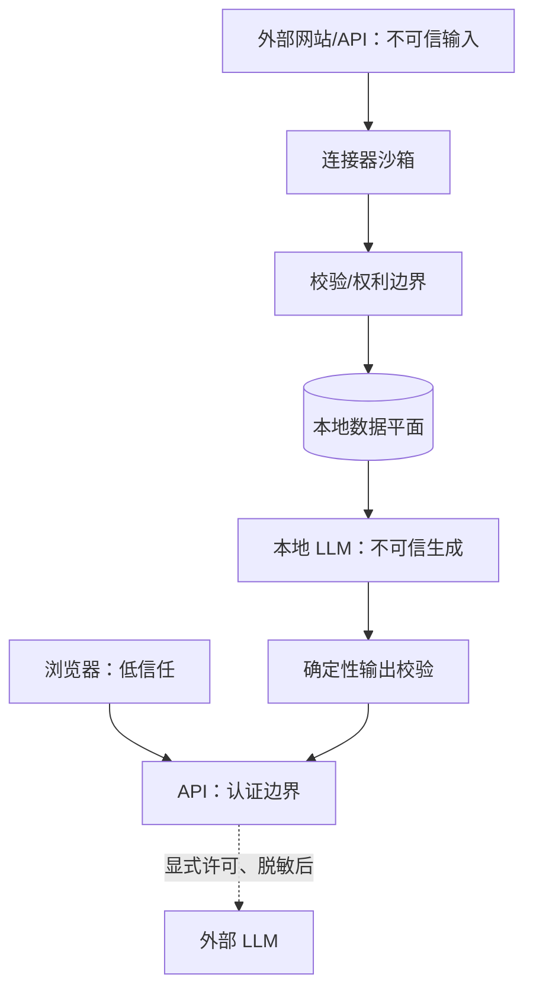

# 安全与隐私威胁模型

## 1. 保护目标

最高敏感资产依次为：

1. 数据源和模型 API 密钥；
2. 持仓数量、成本、账户标识和个人笔记；
3. 获授权但不可传播的新闻/研报/行情；
4. 模型训练集、adapter 和未公开研究结论；
5. 事件、预测、通知和审计完整性；
6. 本地服务和 GPU 的可用性。

威胁主体包括恶意网页内容、被污染的数据源、依赖供应链、误配置、浏览器脚本、本机其他用户、被盗 token 和模型本身的非确定行为。

## 2. 信任边界

外部数据和 LLM 输出都不可信；本地部署不自动意味着安全。

### 私有 R2 Web 预览身份与边界

- 浏览器是 OAuth 公共客户端，只允许 Authorization Code + PKCE，不保存 client secret；token 只进入
  `sessionStorage`，退出和回调地址必须来自同一份强类型 runtime config。
- Cognito 关闭自助注册，只允许管理员创建 `owner`；用户池关闭 MFA，界面只呈现用户名和密码，但浏览器
  后台仍使用 Authorization Code + PKCE。StockMarketAgent 后端不接收密码；数据库不保存邮箱，只保存
  经验证 `sub` 的匿名 SHA-256。
- 后端只接受 RS256 access token，拒绝 issuer/client/`token_use`/时间/JWKS 不匹配、算法回退、重定向
  或非 HTTPS key endpoint；认证依赖不可用时失败关闭。
- CloudFront `/api/v2/*` 不缓存，Authorization 进入零 TTL cache key，其余仅转发 Content-Type、
  Idempotency-Key 与追踪头；ALB 只接受 AWS-managed CloudFront origin-facing prefix list。
- WAF 提供网络层速率上限，应用层另限制每 principal 两个活动会话和每日二十次创建；跨所有者访问统一
  返回不可枚举 404。
- 研究制品 S3 只允许 task role 访问产品 SHA 下的 research 前缀，强制 TLS、SSE、checksum 和七日
  生命周期；静态 Web 发布不使用删除同步，历史对象和旧 stack 均保留。
- DeepSeek 和 Tavily Secret 只进入 worker；worker 没有直接公网 HTTPS 出口，只能经内部 CONNECT 代理
  访问精确域名清单。Tavily 只提供 URL 候选，网页仍须经过来源登记、权利、DNS/IP、robots、重定向、
  PIT 和内容门，搜索摘要不保存也不作为事实。原始网页记录保持 `INELIGIBLE`；只有模型返回的
  连续摘录能在正文中精确定位，且数值和单位均位于该摘录内时，系统才可将其晋升为事实证据。
- API 不具备通用公网 HTTPS 出口；Cognito 公钥只经显式校验的内部代理访问固定 AWS 主机。
  Scheduler 不接入代理，只能访问数据库、队列、DNS、私有 AWS endpoint 和 S3 gateway。

## 3. 主要威胁与控制

| 威胁 | 例子 | 必须控制 |
|---|---|---|
| 密钥泄露 | `.env`、异常堆栈、前端 bundle | 系统密钥链/secret store、字段脱敏、secret scan、密钥轮换 |
| Prompt injection | 新闻正文要求“忽略规则并调用工具” | 文档只进 data message、工具白名单、无直接网络/SQL、输出校验 |
| 数据投毒 | 假新闻、篡改网页、重复舆情 | 来源 allowlist、原文哈希、法定源优先、交叉印证、冲突状态 |
| SSRF | 恶意 URL 指向内网/metadata | 只访问连接器固定域名、DNS/IP 检查、禁重定向到私网 |
| 恶意文件 | PDF 炸弹、脚本、超大压缩包 | 大小/页数/类型限制、无脚本解析容器、超时、隔离对象桶 |
| SQL/命令注入 | ticker 或标题进入查询/命令 | 参数化 SQL、无 shell 拼接、严格 schema、代码白名单 |
| XSS | 新闻 HTML 在页面执行 | 只渲染转义纯文本、CSP、禁止任意 HTML、URL 协议过滤 |
| CSRF/会话盗用 | 本地服务被其他页面调用 | SameSite/HttpOnly/Secure cookie、CSRF token、严格 CORS/Origin |
| 越权外发 | 持仓被发送给云模型 | privacy policy gate、字段级脱敏、显式开关、审计 |
| 模型供应链 | 被替换的权重/adapter | 官方仓库、revision/hash、模型卡、静态 adapter、只读模型卷 |
| 代码供应链 | 恶意 PyPI/npm/镜像更新 | lockfile、hash/digest、Dependabot/审计、最小镜像、SBOM |
| 数据完整性 | worker 重试产生重复或覆盖历史 | 唯一约束、revision、outbox、幂等键、append-only 审计 |
| 可用性 | 连接器/LLM/GPU/队列崩溃 | 超时、熔断、隔离队列、背压、降级为证据列表 |

## 4. 持仓加密

- 数量与成本用应用层信封加密，数据库只存 `ciphertext + key_version`；
- 主密钥放 macOS Keychain 或部署机 secret store，不进入容器镜像；
- 证券代码通常需要检索，保持明文 ID，但访问带 owner scope；
- 备份在离开本机前二次加密；
- 日志、metrics label、Sentry/遥测和模型 prompt 永不包含敏感字段；
- 密钥轮换采用读取旧版本、写入新版本的在线迁移，完成前保留旧密钥只读能力。

## 5. LLM 安全

1. 系统提示、工具定义、证据内容分层序列化；来源文本不能成为 system/tool 消息。
2. 工具不接受原始 SQL、shell、任意 URL 或文件路径。
3. 每个任务只开放必要工具，写操作要求用户命令和审计。
4. JSON Schema 约束后再做业务验证；合法 JSON 不等于事实正确。
5. 事实必须引用，事实数值、日期与证券代码按证据确定性回查。研究正文可以保留有依据的数值、单位和时期；论点的 fact_key、evidence_id 与连续原文摘录先精确匹配，再由现有语义核对步骤逐项检查关键前提、数值、单位、时期、主体、推理及反证是否受到事实支持。该语义核对不是确定性证明；无法判断或无支持的内容不得发布。评分理由和术语仍不得引入新数量或评分，禁止建议交易、目标价与收益承诺。
6. 显式历史研究禁止实时网页发现且截点固定。当前研究的网页发布日期和已知修订时间不得晚于会话创建截点，`first_seen_at` 不得晚于持久化任务期限；发布事务从全部已接纳 citation 复算最终 `as_of`，调用方不能延长期限。
7. 模型输出中的 URL 只允许来自 evidence metadata。
8. 冲突或证据不足时强制 abstain，不让“再想一想”绕过。
9. adapter 动态加载关闭；模型/adapter/processor 文件以 SHA-256 allowlist 校验。

## 6. 数据源和版权风险也是安全风险

连接器扩大权限可能泄漏或违规加工授权数据。运行时 rights gate 根据能力检查 `cache/fulltext/embedding/training/redistribution`；权利过期立即停用，而不是等人工发现。导出/备份任务也执行相同策略。

## 7. 安全测试

- secret fixture 与 Git history scan；
- 100+ prompt injection/越权工具调用样例；
- SSRF 的 IPv4/IPv6、DNS rebinding、重定向和编码变体；
- 恶意 HTML、PDF、SVG、超大正文和压缩炸弹；
- session fixation、CSRF、CORS、CSP、XSS、路径穿越；
- 重放、并发、worker crash 与 outbox exactly-once-effect；
- 模型/adapter 哈希篡改和依赖锁文件篡改；
- 备份泄漏与恢复后的权限校验。

## 8. 事件响应

### 密钥泄露

立即禁用/轮换 token，停止相关连接器，检查 Git、日志、备份和外部调用记录，删除不必要副本，并记录影响时间窗。

### 授权数据误存或误发

熔断连接器，按 `license_id/rights_hash` 定位对象、embedding、缓存、训练 manifest 和导出，执行可审计删除；任何受影响 adapter 停用并重新训练。

### 错误重大通知

冻结事件簇和通知，发布 correction，保留原通知和原因，回溯来源、extractor、rule、prompt 与模型版本，增加回归样例后再恢复。

### 主机入侵

隔离主机、撤销全部密钥、保留磁盘/日志证据，从已验证基础镜像与加密备份重建，不在原主机上“清理后继续用”。

## 9. 未完成控制

R0 只提供结构和策略。密钥链、字段加密、SSRF 过滤、SBOM、漏洞扫描和备份在 R1 前置闸门完成；
登录、CSRF、CSP 和局域网访问保护最迟在 R3 完成。在对应保护完成前只能绑定本机，不能把示例服务暴露到公网或局域网。
